<div align="center">




</div>

<br />

```typescript
const christian = {
  role:       "Senior Software Engineer",
  focus:      ["Full-Stack Development", "AI Engineering", "SaaS Development"],
  experience: "10+ years",
  building:   ["LLM-powered products", "RAG pipelines", "AI agents", "scalable platforms"],
  principles: ["clean architecture", "pragmatic design", "ship, measure, iterate"],
};
```

<br />

<table>
  <tr>
    <td width="33%" valign="top">
      <h3 align="center">Full-Stack & SaaS</h3>
      <p align="center">
        Building fast, accessible interfaces, robust APIs, and scalable SaaS platforms. 
        From idea to production, designed to grow and easy to maintain.
      </p>
    </td>
    <td width="33%" valign="top">
      <h3 align="center">AI Engineering</h3>
      <p align="center">
        LLM integration, retrieval, agents and evaluation. Turning models
        into reliable features users trust.
      </p>
    </td>
    <td width="33%" valign="top">
      <h3 align="center">Cloud & DevOps</h3>
      <p align="center">
        Containerized, observable systems on AWS and GCP. Automated
        pipelines and infrastructure as code.
      </p>
    </td>
  </tr>
</table>

<br />

<h3 align="center">Tech Stack</h3>

<table align="center">
  <tr>
    <td><b>Languages</b></td>
    <td></td>
  </tr>
  <tr>
    <td><b>Frontend</b></td>
    <td></td>
  </tr>
  <tr>
    <td><b>Backend</b></td>
    <td></td>
  </tr>
  <tr>
    <td><b>Data</b></td>
    <td></td>
  </tr>
  <tr>
    <td><b>AI / ML</b></td>
    <td>
      <br />
      <sub>LangChain · LlamaIndex · Hugging Face · OpenAI · Anthropic · pgvector</sub>
    </td>
  </tr>
  <tr>
    <td><b>Cloud & DevOps</b></td>
    <td></td>
  </tr>
</table>

<br />


<div align="center">
  <sub>Currently building production-grade AI systems — always open to interesting problems and great teams.</sub>
</div>
